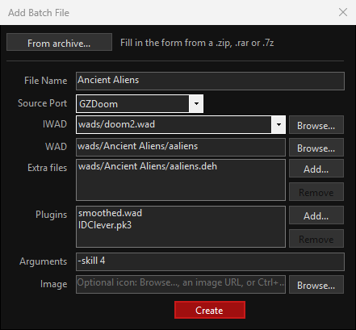

# GZDoom Batch Launcher (a.k.a. Doomer)

</br>

Doomer is a small WinForms app I built while playing some Doom. I always wondered what it would look like to have a simple UI listing all of my <ins>.bat</ins> launchers as clickable icons, instead of digging through a folder — so here it is.

## Requirements

* Windows (x64). The installer bundles the .NET 10 runtime, so no separate .NET install is needed.
* [GZDoom](https://zdoom.org/downloads) and/or [DSDA Doom](https://github.com/kraflab/dsda-doom) installed somewhere on disk.
* Your IWADs, WADs and batch files organized in folders (see Configuration below).

## Configuration

The app reads its settings from `%AppData%\Doomer\appsettings.json`, which is created on first run. You can edit that file directly, or open **Settings** with the gear (⚙) button in the app's menu to change everything (including browsing for the executables and folders) without touching JSON.

```json
{
  "Ports": {
    "GZDoom": {
      "Path": "D:\\gzdoom\\gzdoom.exe",
      "Plugins": "plugins"
    },
    "DSDADoom": {
      "Path": "E:\\DSDA\\dsda-doom.exe"
    }
  },
  "Folders": {
    "Batches": {
      "Path": "D:\\GZDoom\\batchs",
      "Extension": ".bat"
    },
    "Images": {
      "Path": "D:\\GZDoom\\batchs\\Pics",
      "Extension": ".png"
    },
    "Wads": {
      "Path": "D:\\GZDoom\\wads"
    }
  },
  "Interface": {
    "Language": "",
    "Icons": {
      "Width": 120,
      "Height": 100,
      "Padding": 5
    }
  }
}
```

* **Ports.GZDoom.Path**: full path to your `gzdoom.exe`.
* **Ports.GZDoom.Plugins**: GZDoom's plugins folder (relative to your GZDoom install, or a full path), where optional plugins live, e.g. SmoothDoom, Corruption Cards.
* **Ports.DSDADoom.Path**: full path to your `dsda-doom.exe` (optional — only needed for DSDA Doom batches). At least one of the two executables must be set.
* **Folders.Batches**: where your `.bat` launchers live, and their extension.
* **Folders.Images**: where the button icons live, and their extension.
* **Folders.Wads**: where your WADs live. Archives opened with **From archive...** are extracted here, a WAD picked from somewhere else is moved here when its batch is saved, and the IWAD list looks here for IWADs.
* **Interface.Language**: the app's language — `en` (English) or `es` (Español). Leave it empty to follow Windows' language (English if Windows uses one the app isn't translated to).
* **Interface.Icons**: size and spacing of the buttons in the main window.

Settings files from Doomer 1.5.1 and earlier, which kept these under `GZDoom` and `DSDADoom`, are moved to this layout the first time the app starts, and the old file is kept as `appsettings.old.json`.

### Translations

UI texts live in `Doomer/Strings.resx` (English) and one `Strings.<language>.resx` per translation, e.g. `Strings.es.resx`. To add a language, copy `Strings.es.resx` with the new language code, translate its values, and add it to `Localization.Languages` in `Doomer/Localization.cs` so it shows up in Settings. A test checks that every translation has all the strings and the same `{0}` placeholders as English.

## Using the app

The main window lists one button per batch file found in `Folders.Batches.Path`, using the matching image from `Folders.Images.Path` (same file name, different extension) as its icon — falling back to plain text if no image is found. Use the search box in the menu to filter the list by name.

Click a button to run its batch file. It runs without a console window; if it fails (e.g. the executable was moved), Doomer shows the error instead.

Use **Sort** in the menu to list the WADs **By name** or **By last played** (most recent first; WADs never played go last). Mark the ones you play the most as **Favorite** from their right-click menu: they're always shown first, with a gold border. Favorites, play history and the sort order are kept in `%AppData%\Doomer\library.json`.

Right-click any WAD button to:

* Mark or unmark it as a **Favorite**.
* **Edit** its batch file.
* **Change image**: pick a new icon. The file is copied into `Folders.Images.Path`, so the original stays where it was.
* **Open WAD folder**: opens Explorer with the batch's WAD selected. Relative WAD paths are resolved from the source port's folder.
* **Duplicate** it under a new name (e.g. to try the same WAD with another plugin), along with its icon.
* **Delete** it. Deleting a batch also removes its icon image, if one exists.

## Adding a new batch file

Whenever you download a new WAD and want a launcher for it, use **Add Batch File** from the menu:



* <ins>File Name</ins>: the name the batch file (and its button) will use. Its icon is the image with that same name in `Folders.Images.Path`, which the Image field below saves for you.
* <ins>Source Port</ins>: **GZDoom** or **DSDA Doom**. It picks which executable from your settings the batch launches, and how the command is written.
* <ins>IWAD</ins>: the path to the IWAD your WAD was made from. The `.wad` extension is optional — it's added automatically if you leave it out. For example, if your IWADs are under `D:\GZDoom\wads\doom2.wad`, enter `wads/doom2`. The list offers the IWADs your other batches already use, with the same path they have (e.g. `D:\DSDA\doom.wad`), plus any IWAD found in the WADs folder — or type a path.
* <ins>WAD</ins>: the path to the WAD itself, same rule — with or without `.wad`. Other extensions (e.g. `.pk3`) are kept as-is. For the Ancient Aliens WAD at `D:\GZDoom\wads\Ancient Aliens\aaliens.wad`, enter `wads/Ancient Aliens/aaliens`.
* <ins>Extra files (optional)</ins>: other files loaded right after the WAD, such as `.deh`/`.bex` patches or a music WAD. Add them with **Add...** or by dropping them from Explorer onto the list, and take them out with **Remove** (or the Delete key).
* <ins>Plugins (optional, GZDoom only)</ins>: extra files you want loaded alongside the WAD (e.g. SmoothDoom, Corruption Cards, IDClever), as many as you like. **Add...** lists the `.wad`/`.pk3`/`.pk7`/`.zip`/`.deh`/`.bex` files in the `Ports.GZDoom.Plugins` folder (relative to your GZDoom install) that the batch doesn't have yet; **Remove** (or the Delete key) takes them out. They're loaded last, in the order they're listed. If a plugin isn't in the folder when you save, you'll be asked to confirm.
* <ins>Arguments (optional)</ins>: anything else to pass to the source port, written at the end of the command as you type it, e.g. `-skill 4 -warp 1`, or `-complevel 9` for DSDA Doom. Arguments added by hand at the end of a batch's command show up here when you edit it, so saving it keeps them.
* <ins>Image (optional)</ins>: the icon for the WAD's button. Pick a file with **Browse...**, paste the image's URL (right-click the image in your browser > Copy image address; it's downloaded when you save), or right-click the image > Copy image and press **Ctrl+V** in the Image box. Either way the image is stored in `Folders.Images.Path` under the batch's name; a file picked with **Browse...** is copied, so the original stays where it was. Some sites, like Doom Wiki, block downloads from apps — use Copy image + Ctrl+V for those.

If a batch file with the same name already exists, you'll be asked to confirm before it's overwritten. If you enter a full (rooted) path for IWAD, WAD or an extra file that doesn't exist on disk, you'll also get a confirmation before the batch is created — relative paths aren't checked, since they're resolved by the source port at launch time, not by Doomer. A WAD picked from outside `Folders.Wads.Path` is moved into it when you save, and the batch points to its new place.

Both IWAD and WAD have a **Browse...** button to pick the file instead of typing the path.

If you just downloaded a WAD as an archive (`.zip`, `.rar` or `.7z`), use **From archive...** at the top of the form. It extracts the archive into its own folder inside the WADs directory named after it with each word capitalized (e.g. `D.O.O.M..rar` → `<WADs>\D.O.O.M\`, `ancient aliens.zip` → `<WADs>\Ancient Aliens\`) — if everything in the archive is inside a single folder, that folder's contents go straight into it — fills in WAD with the `.wad`/`.pk3`/`.pk7` it finds there (asking you to pick one if there are several), and, for a new batch, uses the folder name as the File Name. Before extracting, it shows the suggested name so you can keep it or type a different one. You can also drag the archive from Explorer and drop it on Doomer's main window: Add Batch File opens and goes straight to that step.

The end result is a `.bat` file with a command like this:

```
GZDoom:    "D:\gzdoom\gzdoom" -iwad "wads/doom2.wad" -file "wads/Ancient Aliens/aaliens.wad"
DSDA Doom: "E:\DSDA\dsda-doom" "WadSmoosh/source_wads/tnt.wad" "wads/D.O.O.M\DrakeRC2.wad" -complevel 9
```

A GZDoom batch with plugins also gets a first line, `rem Doomer plugins folder: plugins`, recording the plugins folder it was written with. That way its plugins are still recognized when you edit it after changing the folder in Settings; when you save it again, they're written under the new folder.

## Building and testing

```
dotnet build
dotnet test
```

`Doomer.Tests` covers the services in `Doomer/Services`: building and parsing batch commands, launching batches, extracting archives, finding IWADs and plugins, icons, favorites and play history, and the update check (including the installer's SHA-256). It also checks that every translation has all the strings.

## Creating an installer

To build a distributable installer that doesn't require .NET or Visual Studio on the target machine:

1. Install [Inno Setup](https://jrsoftware.org/isinfo.php) (one-time, on the machine building the installer).
2. Run:
   ```powershell
   .\installer\publish.ps1 -Version 1.0.0
   ```

This publishes a self-contained, single-file build of the app (bundling the .NET runtime) and, if Inno Setup is found, compiles it into `installer\Output\DoomerSetup-<version>.exe`. That single file is all you need to hand out — it installs the app, creates Start Menu/desktop shortcuts, and registers an uninstaller.

## Releasing an update

On startup, Doomer checks the [latest GitHub release](https://github.com/JPDKR/Doomer/releases/latest). If its tag is newer than the installed version, the app offers to update: it downloads the `DoomerSetup-<version>.exe` attached to the release, checks it against the SHA-256 GitHub publishes for it, installs it silently and relaunches. An installer that doesn't match, or a release without that hash, isn't run. Choosing **Skip this version** stops it from asking about that version again; a newer one is still offered. Your settings live in `%AppData%\Doomer`, so updating doesn't touch them.

To publish a new version, push a version tag:

```
git tag v1.1.0
git push origin v1.1.0
```

The `Release` workflow builds the installer for that version and attaches it to a new GitHub release.

## Roadmap

- [x] Support multiple WAD/plugin files per batch.
